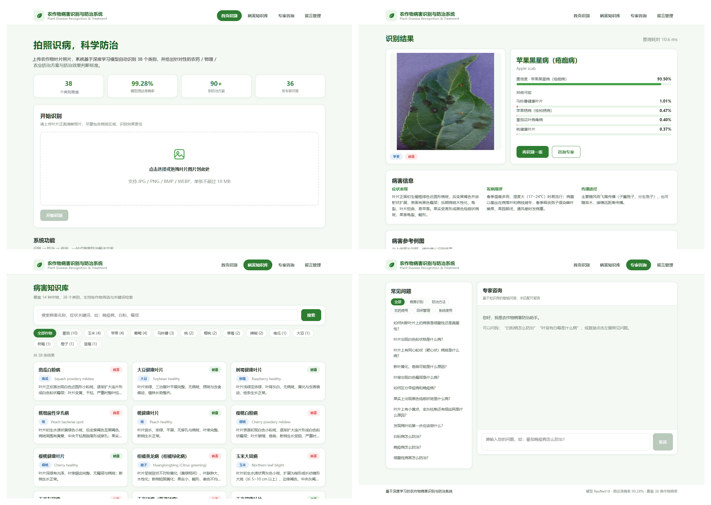
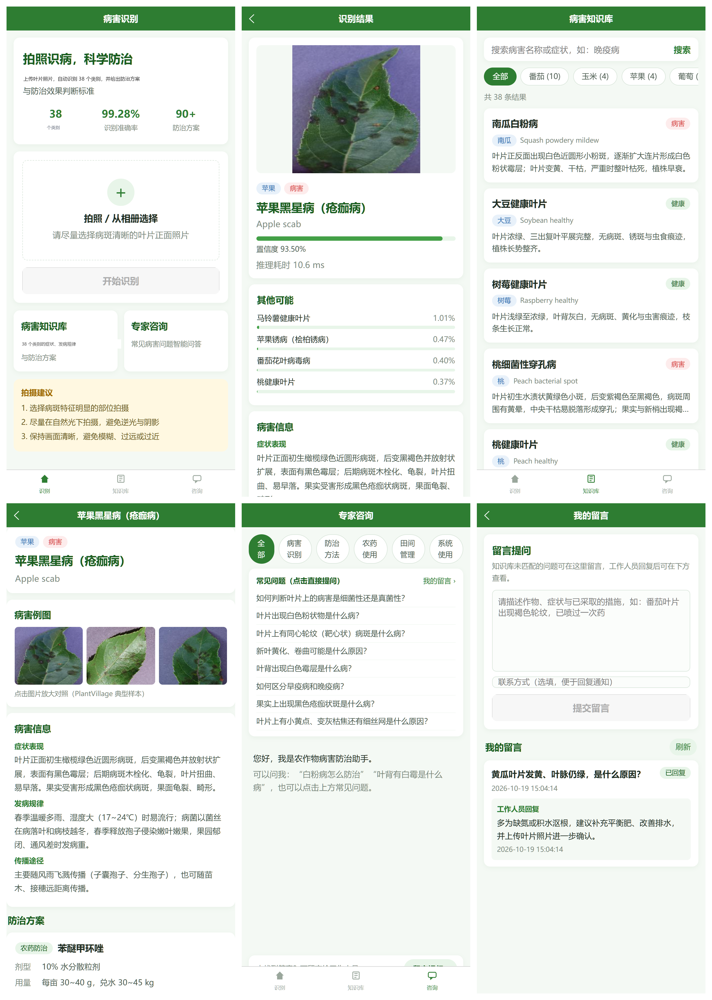
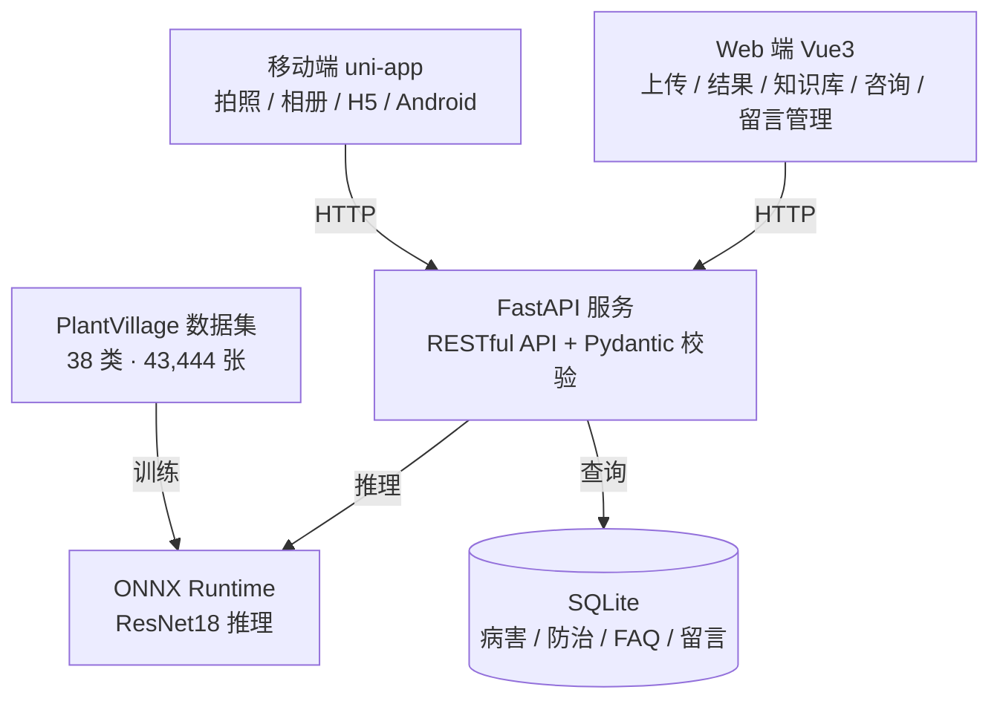

# 基于深度学习的农作物病害识别与防治系统

面向农户的农作物叶片病害识别与防治系统：上传一张叶片照片，返回病害类别、置信度与 Top-5 候选，并给出**农药 / 物理 / 农业**三类防治方案（含预期效果、见效时间、判断标准），配套病害知识库、FAQ 咨询与留言回复。提供 **Vue3 Web 端**与 **uni-app 移动端**。


## 功能

- **图像识别**：覆盖 PlantVillage 38 个类别（14 种作物），ResNet18 迁移学习，输出 Top-5 与置信度；
- **防治推荐**：按识别结果给出农药、物理、农业三类方案，每条包含预期效果、见效时间、判断标准与未达预期处理；
- **病害知识库**：38 类病害的症状、发病规律、传播途径与典型例图，支持作物筛选、关键词搜索与分页；
- **专家咨询**：36 条 FAQ，关键词 + 字符二元组相似度匹配，未匹配时转入留言；
- **留言回复**：用户提交问题，Web 管理端回复，移动端按留言 ID 查询状态；
- **双端支持**：Vue3 Web 端（上传 / 结果 / 知识库 / 详情 / 咨询 / 留言管理）与 uni-app 移动端（拍照、相册、H5 / Android）。

## 界面预览

**Web 端**（首页识别 / 识别结果 / 病害知识库 / 专家咨询）



**移动端**（识别 / 结果 / 知识库 / 详情 / 咨询 / 留言）



## 系统架构



## 模型与结果

同一数据划分（7 : 1.5 : 1.5，seed 42）、同一训练策略下对比 6 个深度模型，测试集结果：

| 模型 | 准确率 | 宏 F1 | 参数量 | 模型体积 | CPU 单张 |
| --- | ---: | ---: | ---: | ---: | ---: |
| ResNet18（部署主模型） | 99.28% | 98.96% | 11.20 M | 42.7 MB | 9.7 ms |
| ResNet34 | 99.69% | 99.54% | 21.30 M | 81.3 MB | 20.9 ms |
| ResNet50 | 99.40% | 99.28% | 23.59 M | 89.9 MB | 23.0 ms |
| AlexNet（改造分类头） | 98.40% | 97.20% | 2.82 M | 10.8 MB | 3.7 ms |
| MobileNetV2 | 99.71% | 99.46% | 2.27 M | 8.6 MB | 2.9 ms |
| MobileNetV3-Large | 99.66% | 99.50% | 4.25 M | 16.2 MB | 2.9 ms |

补充实验：

- **传统分类器**：用 ResNet18 的 512 维 GAP 特征训练 SVM / KNN / 决策树 / 随机森林，微调特征下随机森林达到 99.49%，说明特征质量比分类器复杂度更关键；
- **数据审计**：SHA256 精确去重、dHash + NCC 近同图检测、Laplacian 模糊检测，生成隔离清单与清洗版划分；
- **模型压缩**：ONNX 动态量化把 ResNet18 压到 10.7 MB（4.0×），在 1,000 张测试图上 argmax 一致率 99.8%。

各网络逐层 shape、模块内部计算与完整实验细节见 [docs/模型介绍.md](docs/模型介绍.md)。

## 目录结构

```text
.
├── model/                 # 训练与导出：train.py / train_ml.py / export_onnx.py / audit_dataset.py
│   ├── data/              # 分层划分、数据增强、DataLoader
│   ├── nets/              # ResNet / AlexNet / MobileNet 模型库
│   └── utils/             # 训练引擎、指标、断点、日志
├── backend/               # FastAPI 服务
│   ├── app/               # routers（predict / diseases / consult / messages / health）+ services
│   ├── data/              # 38 类病害 JSON + faq.json
│   ├── scripts/           # 知识库导入 SQLite
│   ├── static/examples/   # 每类典型例图
│   └── tests/             # 23 项 pytest 接口测试
├── web/                   # Vue3 + Vite Web 端
├── mobile/                # uni-app 移动端
├── docs/                  # 模型说明与逐层流程图
└── README.md
```

## 快速开始

### 1. 准备数据与模型

```bash
# 下载 PlantVillage（38 类，按类别目录存放）
# https://www.kaggle.com/datasets/mohitsingh1804/plantvillage/data
# 放到项目根目录 PlantVillage/ 下

cd model
pip install -r requirements.txt

# 训练 ResNet18（CPU 约 16 h；有 GPU 可自行调整）
python train.py --model resnet18 --epochs 30 --batch-size 32

# 导出 ONNX + 动态量化 + 一致性校验
python export_onnx.py --model resnet18 --quantize --verify
```

训练产物在 `model/checkpoints/resnet18/`，ONNX 在 `model/onnx_models/`。

### 2. 后端（8000）

```bash
cd backend
pip install -r requirements.txt

# 把模型与类别表放到 backend/models/
# resnet18.onnx / classes.txt 来自 model/onnx_models/
python scripts/import_knowledge.py      # 首次启动也会自动导入
uvicorn app.main:app --host 0.0.0.0 --port 8000

python -m pytest                        # 23 项接口测试
```

Swagger 文档：`http://localhost:8000/docs`。

### 3. Web 端（5173）

```bash
cd web
npm install
npm run dev        # /api 代理到 127.0.0.1:8000
npm run build
```

### 4. 移动端（H5 5174）

```bash
cd mobile
npm install
npm run dev:h5     # http://127.0.0.1:5174
```

App / 小程序用 HBuilderX 打开 `mobile/` 运行或云打包；打包前把 `mobile/manifest.json` 的 `appid` 换成自己的 DCloud 应用 ID，并把 `mobile/api/index.js` 的 `BASE_URL` 指向后端地址。

## 说明

- 本仓库**不包含** PlantVillage 数据集、训练权重（`.pth`）与导出的 ONNX 模型，请按上面的步骤自行训练/导出；
- 数据集版权归 PlantVillage 原作者所有，使用时请遵循其许可；
- 界面中的联系方式、留言等均为演示数据。

## License

[MIT](LICENSE)
