# 项目模型介绍（深度学习 + 传统机器学习）

> 项目：基于深度学习的农作物病害识别与防治系统
> 本文覆盖 readme「模型对比」中列出的全部模型：**6 个深度网络**（ResNet18 / ResNet34 / ResNet50 / AlexNet / MobileNetV2 / MobileNetV3-Large）+ **5 种传统机器学习分类器**（线性 SVM / SVM-RBF / KNN / 决策树 / 随机森林）
> 相关代码：`model/train.py`（深度训练）、`model/train_ml.py`（传统对比）、`model/nets/zoo.py`（模型库）、`model/export_onnx.py`（部署导出）

---

## 1. 模型总览

### 1.1 模型清单

| 类别 | 模型 | 代码标识 | 在本项目中的角色 | 当前状态 |
| --- | --- | --- | --- | --- |
| 深度学习 | ResNet18 | `resnet18` | 部署主模型 | 已完成：测试准确率 99.28% |
| 深度学习 | ResNet50 | `resnet50` | 网络深度对比（主模型候选） | 已完成：测试准确率 99.40% |
| 深度学习 | ResNet34 | `resnet34` | 可选对比（网络深度消融） | 已完成：测试准确率 99.69% |
| 深度学习 | AlexNet | `alexnet` | 经典 CNN 结构对比 | 已完成：测试准确率 98.40% |
| 深度学习 | MobileNetV2 | `mobilenet_v2` | 轻量级网络对比（面向移动端） | 已完成：测试准确率 99.71% |
| 深度学习 | MobileNetV3-Large | `mobilenet_v3_large` | 轻量级网络对比（面向移动端） | 已完成：测试准确率 99.66% |
| 传统机器学习 | 线性 SVM | `SVM` | 深度特征 + 经典分类器基线 | 已完成（两轮特征实验） |
| 传统机器学习 | SVM-RBF | `SVM-RBF` | 非线性核分类器对比 | 已完成（两轮特征实验） |
| 传统机器学习 | KNN | `KNN` | 惰性学习基线 | 已完成（两轮特征实验） |
| 传统机器学习 | 决策树 | `DecisionTree` | 单模型基线 | 已完成（两轮特征实验） |
| 传统机器学习 | 随机森林 | `RandomForest` | 集成学习基线 | 已完成（两轮特征实验） |

### 1.2 统一实验设置（保证对比公平）

- **数据集**：PlantVillage，38 类 / 43,444 张，覆盖 14 种作物；
- **数据划分**：分层抽样 7 : 1.5 : 1.5 = 训练 30,412 / 验证 6,517 / 测试 6,515，所有深度模型共用同一划分文件（`model/data/splits/plantvillage_r70_15_15_seed42.json`）；
- **深度模型**：统一 30 epoch、batch size 32、ImageNet 预训练权重迁移学习、相同数据增强；
- **传统模型**：统一使用 ResNet18 提特征（512 维）+ 相同测试集；
- **评价指标**：准确率、macro 精确率 / 召回率 / F1、weighted F1、混淆矩阵。

### 1.3 两条技术路线

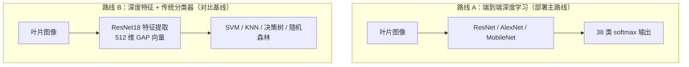

---

## 2. 深度学习模型基础与训练方案

### 2.1 卷积神经网络的基本组成

深度模型把图像分类拆成"逐层提取特征 → 最后分类"两步：

| 组件 | 作用 |
| --- | --- |
| 卷积层（Conv） | 用可学习的卷积核在图像上滑动，提取边缘、纹理、形状等局部特征；浅层学低级特征，深层学语义特征 |
| 激活函数（ReLU） | 引入非线性，使网络能拟合复杂函数；`ReLU(x) = max(0, x)` |
| 池化层（Pool / 步长卷积） | 下采样、扩大感受野、降低计算量，并提供一定平移不变性 |
| 全局平均池化（GAP） | 把每个通道的特征图压缩成一个数，得到整图语义向量（ResNet 的 512 维特征即来自这里） |
| 全连接层（FC） | 把特征向量映射成 38 个类别的得分 |
| Softmax + 交叉熵 | 把得分变成概率并计算损失，反向传播更新全部参数 |

训练的目标是让交叉熵损失最小：预测正确类别的概率越高，损失越小。网络参数通过反向传播和 Adam 优化器迭代更新。

### 2.2 迁移学习：为什么加载 ImageNet 预训练权重

PlantVillage 有 4 万多张图，但直接从随机初始化训练深层网络仍然容易过拟合、收敛慢。迁移学习分两步：

1. **预训练**：网络先在 ImageNet（1000 类、百万级自然图像）上学到通用的边缘、纹理、形状特征；
2. **微调**：把分类头换成 38 类，在叶片病害数据上继续训练，通用特征向"病斑、霉层、叶色变化"等农业特征迁移。

本项目的 6 个深度网络全部采用这一方案（`build_model(..., pretrained=True)`），并统一替换分类头为 38 类输出，保证对比公平。

### 2.3 训练方案（所有深度模型一致）

| 项目 | 设置 |
| --- | --- |
| 损失函数 | 交叉熵损失 CrossEntropyLoss（含标签平滑） |
| 优化器 | Adam |
| 学习率调度 | CosineAnnealingLR（带 Linear Warmup） |
| 防过拟合 | Early Stopping 早停、数据增强（随机旋转 / 水平垂直翻转 / 色彩抖动 / 随机裁剪 / 高斯噪声）、标签平滑 |
| 类别不平衡 | 类别加权损失、过采样 |
| 断点续训 | 每个 epoch 保存 `last.pth` / `best.pth`，支持 `--resume auto` |

### 2.4 评估与部署

- 评估：测试集准确率、精确率、召回率、F1（macro / weighted）、混淆矩阵（`model/logs/<模型名>/`）；
- 部署：PyTorch 权重导出为 ONNX，再用动态量化压缩体积、提升推理速度（`model/export_onnx.py`）。

---

## 3. ResNet 系列（ResNet18 / ResNet34 / ResNet50）

### 3.1 要解决的问题：深层网络的退化

理论上网络越深表达能力越强，但实验发现：把普通网络从 20 层加深到 56 层，**训练误差反而变大**（不是过拟合，而是难以优化）。ResNet 用"残差连接"解决了这个问题。

### 3.2 残差学习原理

ResNet 在每个模块上加了一条"捷径"（shortcut），让模块只学习"变化量"：

```text
普通模块：y = F(x)          （F 是两层卷积）
残差模块：y = F(x) + x      （跨层连接把输入直接加到输出）
```

直觉理解：

- 如果某层不需要改变特征，网络只需把 `F(x)` 学成 0，输出就是 `x`（恒等映射），不会因加深而"学坏"；
- 反向传播时梯度可以通过捷径直接回传，缓解梯度消失，使 50 层甚至上百层都能稳定训练；
- 捷径连接本身没有参数，不增加计算量。

### 3.3 两种残差块

| 块类型 | 结构 | 使用模型 |
| --- | --- | --- |
| BasicBlock | 3×3 卷积 → BN → ReLU → 3×3 卷积 → BN，再加捷径 | ResNet18 / ResNet34 |
| Bottleneck | 1×1 降维 → 3×3 卷积 → 1×1 升维（通道数 ×4），再加捷径 | ResNet50 及更深模型 |

Bottleneck 先用 1×1 把通道数压到 1/4 做 3×3 卷积，再用 1×1 还原，在更深的网络上反而比 BasicBlock 更省算力。

### 3.4 三种规格对比

| 模型 | 残差块 | 各阶段层数 | 层数（卷积+FC） | 参数量（1000 类 / 本项目 38 类，约） | 特点 |
| --- | --- | --- | ---: | --- | --- |
| ResNet18 | BasicBlock | [2, 2, 2, 2] | 18 | 11.69 M / **11.20 M** | 最轻，训练最快，实测已达标 |
| ResNet34 | BasicBlock | [3, 4, 6, 3] | 34 | 21.80 M / 21.30 M | 深度居中，可选消融 |
| ResNet50 | Bottleneck | [3, 4, 6, 3] | 50 | 25.56 M / 23.59 M | 最深、表达力最强，训练成本最高 |

> 本项目 38 类参数量 = 官方 1000 类参数量减去分类头差额换算所得，ResNet18 的 11.20 M 与 readme 实测一致。

三个模型的整体结构相同：7×7 卷积 + 最大池化 → 4 个残差阶段（通道 64/128/256/512）→ 全局平均池化 → 全连接分类头。因此它们的 GAP 特征都是 **512 维**，这也是 `train_ml.py` 能用同一套特征做传统分类器实验的原因。

### 3.5 在本项目中的用法

```bash
python model/train.py --model resnet18 --epochs 30 --batch-size 32
python model/train.py --model resnet50 --epochs 30 --batch-size 32
```

- 加载 ImageNet 权重，替换 `fc` 为 `Linear(512, 38)`；
- 全网络微调（非只训分类头），30 epoch，早停防止过拟合；
- 导出 ONNX 用于后端部署，并可用 `best.pth` 给传统分类器提特征。

### 3.6 优点与局限

**优点**

- 结构简洁、通用性强，是图像分类最常用的骨干网络之一；
- 残差连接使深层网络可训练，精度随深度平稳提升；
- 对本数据集这样的类间差异明显的叶片图像，ResNet18 就能达到很高精度（实测 99.28%）。

**局限**

- ResNet50 参数量、计算量约为 ResNet18 的 2.3 倍，CPU 训练约需 50~55 小时（实测每轮约 1.65 h），移动端部署偏重；
- 相比 MobileNet 系列，没有为移动端做专门优化；
- 本项目数据背景单一（实验室环境叶片），实际田间复杂场景的泛化能力仍需验证。

### 3.7 实验结果

| 模型 | 测试准确率 | 精确率 (macro) | 召回率 (macro) | F1 (macro) | F1 (weighted) | 参数量 | 模型大小 | 单张推理 | 训练耗时 |
| --- | ---: | ---: | ---: | ---: | ---: | ---: | ---: | ---: | ---: |
| ResNet18 | **99.28%** | 98.71% | 99.23% | 98.96% | 99.28% | 11.20 M | 42.7 MB（量化 10.7 MB） | 9.7 ms（量化 15.4 ms） | 16.3 h |
| ResNet34 | 99.69% | 99.46% | 99.64% | 99.54% | 99.69% | 21.30 M | 81.3 MB（量化 20.4 MB） | 20.9 ms（量化 31.2 ms） | 约 1.7 h（另机 RTX 3060） |
| ResNet50 | 99.40% | 99.24% | 99.35% | 99.28% | 99.40% | 23.59 M | 89.9 MB（量化 22.7 MB） | 23.0 ms（量化 31.5 ms） | 52.1 h |

> 训练产物：`model/checkpoints/<模型名>/`、`model/logs/<模型名>/`；部署模型：`model/onnx_models/`。

---

## 4. AlexNet

### 4.1 结构与工作原理

AlexNet 是 2012 年 ImageNet 竞赛冠军，也是深度学习在计算机视觉中崛起的标志。它由 **5 个卷积层 + 3 个全连接层**组成（约 8 个可学习层）：

```text
输入 224×224
→ conv 11×11/4 + ReLU + 池化
→ conv 5×5   + ReLU + 池化
→ conv 3×3 + ReLU
→ conv 3×3 + ReLU
→ conv 3×3 + ReLU + 池化
→ 全连接 4096 → 全连接 4096 → 输出 1000 类
```

### 4.2 历史性改进

| 技术 | 作用 |
| --- | --- |
| ReLU | 替代 Sigmoid / Tanh，缓解梯度消失，训练速度大幅提升 |
| Dropout | 全连接层随机丢弃神经元，抑制过拟合 |
| 重叠最大池化 | 池化窗口有重叠，特征更丰富 |
| 数据增强 | 随机裁剪、翻转、颜色扰动，扩大训练样本 |
| GPU 并行训练 | 首次证明深层 CNN 大规模训练的可行性 |

### 4.3 本项目中的改造

torchvision 的 AlexNet 分类头是 3 层全连接（9216 → 4096 → 4096 → 1000），参数量约 61.1 M，其中分类头占 58.6 M。本项目在 `nets/zoo.py` 中把整个分类头替换为**单层** `Linear(9216, 38)`：

- 参数量从约 61.1 M 降到约 **2.8 M**，训练与导出成本大幅下降；
- 保留其经典卷积结构作为"前深度学习时代向深度学习过渡"的对照。

### 4.4 优点与局限

**优点**

- 结构经典直观，是理解 CNN 的最佳教学网络；
- 引入了 ReLU、Dropout 等沿用至今的设计；
- 卷积部分参数量其实不大（约 2.5 M），改造后很适合做轻量对比。

**局限**

- 原版分类头参数冗余巨大，计算量高；
- 大卷积核（11×11、5×5）相比现代 3×3 堆叠结构参数效率低；
- 深度只有 8 层，表达能力弱于 ResNet 系列，预期精度略低。

### 4.5 实验结果

| 指标 | 数值 |
| --- | ---: |
| 测试准确率 | 98.40% |
| 精确率（macro） | 96.74% |
| 召回率（macro） | 98.10% |
| F1（macro） | 97.20% |
| F1（weighted） | 98.45% |
| 参数量 | 2.82 M |
| 模型大小 | 10.8 MB（量化 2.7 MB） |
| 单张推理 | 3.7 ms（量化 6.9 ms） |
| 训练耗时 | 约 4.9 h（本机 CPU，30/30 epoch） |

> 最优 epoch 26（val 98.45%）；首轮 lr=1e-3 训练崩溃后归档断点，改用 lr=1e-4 从头重训。ONNX 一致性最大误差 1.91e-06（量化 0.3806）。

---

## 5. MobileNetV2

### 5.1 核心思想：深度可分离卷积

普通卷积同时对空间和通道做运算；深度可分离卷积把它拆成两步，大幅减少计算量：

```text
普通卷积：每个输出通道对所有输入通道做 3×3 卷积      计算量 ≈ k² · Cin · Cout · H · W
深度可分离卷积：
  第一步 逐通道卷积（Depthwise）：每个输入通道独立做 3×3 卷积
  第二步 逐点卷积（Pointwise）：1×1 卷积做通道融合
```

参数量与计算量约降为普通卷积的 `1/Cout + 1/k²`（k=3、Cout 较大时可减少 8~9 倍），代价是通道间信息交互变弱。

### 5.2 倒残差结构与线性瓶颈

MobileNetV2 在深度可分离卷积基础上提出两个结构：

1. **倒残差（Inverted Residual）**：先用 1×1 把通道数**扩张**（默认 6 倍）→ 3×3 深度卷积 → 1×1 压缩回原通道；当输入输出形状相同时加捷径连接。与传统残差"先压后扩"相反，故称"倒"残差；
2. **线性瓶颈（Linear Bottleneck）**：压缩层（输出通道少）后面**不加 ReLU**，避免低维特征被激活函数破坏信息。

```text
倒残差块：1×1 扩张(ReLU6) → 3×3 深度卷积(ReLU6) → 1×1 投影(无激活) → + 捷径
```

### 5.3 优点与局限

**优点**

- 参数量仅约 3.5 M（本项目 38 类约 2.3 M），远小于 ResNet18；
- 计算量（FLOPs）低，推理速度快，专为移动端 / 嵌入式设计；
- 在轻量网络中精度表现优秀，适合打包到手机 App 做实时识别。

**局限**

- 深度可分离卷积在部分 CPU 实现上并行度低，实际速度优势不一定完全兑现；
- 表达能力有限，精度通常略低于同深度普通卷积网络；
- 用于本项目时需实测推理速度与精度的平衡。

### 5.4 实验结果

| 指标 | 数值 |
| --- | ---: |
| 测试准确率 | 99.71% |
| 精确率（macro） | 99.30% |
| 召回率（macro） | 99.64% |
| F1（macro） | 99.46% |
| F1（weighted） | 99.71% |
| 参数量 | 2.27 M |
| 模型大小 | 8.6 MB（量化 2.3 MB） |
| 单张推理 | 2.9 ms（量化 22.3 ms） |
| 训练耗时 | 约 20.4 h（本机 CPU，30/30 epoch） |

> 最优 epoch 26（val 99.59%）；ONNX 一致性最大误差 1.91e-06（量化 0.19）。

---

## 6. MobileNetV3-Large

### 6.1 设计方法：NAS + NetAdapt

MobileNetV3 不再完全由人工设计，而是"算法搜索 + 人工微调"结合：

- **NAS（神经架构搜索）**：用平台感知的自动化搜索（MnasNet 思路）在精度与延迟目标下搜索网络结构；
- **NetAdapt**：对搜索出的网络逐层精简通道数，在精度损失可接受的前提下进一步压缩。

### 6.2 关键改进

| 改进 | 说明 |
| --- | --- |
| Squeeze-and-Excitation（SE） | 在瓶颈结构中加轻量注意力：先全局池化得到通道描述，再学习各通道权重并重标定，让网络"关注重要通道" |
| h-swish 激活 | `h-swish(x) = x · ReLU6(x + 3) / 6`，是 swish 的硬件友好近似，比 Sigmoid 类激活更快，比 ReLU 精度更好 |
| 精简尾部结构 | 重设计最后阶段与分类头，减少一次昂贵的 3×3 卷积和 1×1 通道扩展，降低延迟 |

### 6.3 优点与局限

**优点**

- 同等延迟下精度优于 MobileNetV2，是移动端部署的代表性网络；
- SE 注意力与 h-swish 带来精度增益，参数量仍仅约 5.5 M（本项目 38 类约 4.3 M）；
- 与本项目"移动端 App 拍照识别"的落地场景高度契合。

**局限**

- 结构由搜索得到，可解释性弱（哪个模块为什么有效难以逐层解释）；
- SE 模块与 h-swish 的算子实现依赖部署框架优化，ONNX Runtime / 手机端支持程度需验证；
- 精度上限仍不如 ResNet50 等重型网络。

### 6.4 实验结果

| 指标 | 数值 |
| --- | ---: |
| 测试准确率 | 99.66% |
| 精确率（macro） | 99.47% |
| 召回率（macro） | 99.54% |
| F1（macro） | 99.50% |
| F1（weighted） | 99.66% |
| 参数量 | 4.25 M |
| 模型大小 | 16.2 MB（量化 4.3 MB） |
| 单张推理 | 2.9 ms（量化 22.4 ms） |
| 训练耗时 | 约 16.1 h（本机 CPU，30/30 epoch） |

> 最优 epoch 29（val 99.54%）；ONNX 一致性最大误差 1.07e-06（量化 0.20）。

---

## 7. 深度学习模型横向对比

### 7.1 定性对比

| 模型 | 参数量（约） | 核心结构 | 优势 | 劣势 | 定位 |
| --- | ---: | --- | --- | --- | --- |
| ResNet18 | 11.2 M | BasicBlock ×4 阶段 | 精度高、训练快、通用 | 移动端偏重 | **部署主模型** |
| ResNet34 | 21.3 M | BasicBlock 加深 | 精度略升 | 本机约 25 h（另机 1.7 h） | 可选消融 |
| ResNet50 | 23.6 M | Bottleneck | 表达力最强 | 训练 50~55 h，部署重 | 深度对比 |
| AlexNet | 2.8 M（改造后） | 5 conv + 大核 | 经典、结构简单 | 表达力弱、大核低效 | 经典对照 |
| MobileNetV2 | 2.3 M | 深度可分离 + 倒残差 | 极轻、推理快 | 精度略低、CPU 并行度差 | 移动端候选 |
| MobileNetV3-L | 4.3 M | NAS + SE + h-swish | 轻量且精度好 | 结构复杂、部署算子依赖 | 移动端候选 |

> 参数量为按 38 类分类头换算的预估值，实际以训练日志为准。

### 7.2 结果汇总（截至当前）

| 模型 | 测试准确率 | F1 (macro) | F1 (weighted) | 模型大小 | 单张推理 | 训练耗时 |
| --- | ---: | ---: | ---: | ---: | ---: | ---: |
| ResNet18 | 99.28% | 98.96% | 99.28% | 42.7 MB（量化 10.7 MB） | 9.7 ms（量化 15.4 ms） | 16.3 h |
| ResNet50 | 99.40% | 99.28% | 99.40% | 89.9 MB（量化 22.7 MB） | 23.0 ms（量化 31.5 ms） | 52.1 h |
| ResNet34（可选） | 99.69% | 99.54% | 99.69% | 81.3 MB（量化 20.4 MB） | 20.9 ms（量化 31.2 ms） | 约 1.7 h（另机 RTX 3060） |
| AlexNet | 98.40% | 97.20% | 98.45% | 10.8 MB（量化 2.7 MB） | 3.7 ms（量化 6.9 ms） | 约 4.9 h |
| MobileNetV2 | 99.71% | 99.46% | 99.71% | 8.6 MB（量化 2.3 MB） | 2.9 ms（量化 22.3 ms） | 20.4 h |
| MobileNetV3-Large | 99.66% | 99.50% | 99.66% | 16.2 MB（量化 4.3 MB） | 2.9 ms（量化 22.4 ms） | 16.1 h |

### 7.3 主模型如何确定

ResNet18 / ResNet34 / ResNet50 使用相同划分、相同轮数训练后，在同一测试集上比较准确率、参数量、模型大小与推理耗时。ResNet34 与 ResNet50 测试准确率分别为 99.69% 与 99.40%，均高于 ResNet18 的 99.28%，但参数量约为 ResNet18 的 1.9 / 2.1 倍（21.30 M / 23.59 M vs 11.20 M），综合识别精度与推理效率，最终选定 **ResNet18** 作为部署主模型。其余网络（AlexNet、MobileNetV2/V3）用于分析网络结构、深度与轻量化对性能的影响，为论文提供对比数据。

---

## 8. 传统机器学习模型

### 8.1 总体流程

传统路线不直接对图像建模，而是复用深度网络提取的特征：

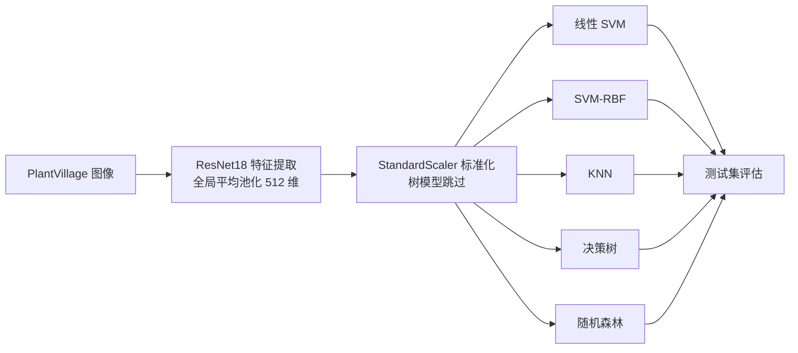

两轮实验使用相同数据划分与分类器参数，只更换特征来源：

| 轮次 | 特征来源 | 含义 | 结果目录 |
| --- | --- | --- | --- |
| 第一轮 | ImageNet 预训练 ResNet18 | 通用自然图像特征 | `model/logs/ml/` |
| 第二轮 | 本项目微调 ResNet18 `best.pth` | 面向叶片病害的领域特征 | `model/logs/ml_finetuned/` |

### 8.2 线性 SVM

- **原理**：寻找最大间隔超平面，决策函数 `f(x) = w·x + b`，优化目标 `min 1/2·||w||² + C·Σ max(0, 1 - yᵢ(w·xᵢ+b))`；只有支持向量决定边界；`C` 控制间隔宽度与容错的权衡；多分类用 OvR；
- **本项目参数**：`StandardScaler` + `LinearSVC(C=1.0, max_iter=3000, class_weight="balanced", dual="auto")`；
- **优点**：高维小样本友好、理论完备、推理仅一次点积；
- **局限**：只能产生线性边界、对缩放与 `C` 敏感、需 OvR 组合；
- **结果**：ImageNet 特征 94.80% → 微调特征 99.46%（提升约 4.7 个百分点）。

### 8.3 SVM-RBF（高斯核 SVM）

- **原理**：用核技巧把样本隐式映射到高维，在那里线性可分，对应原空间的非线性边界；`K(x,z) = exp(-γ·||x-z||²)`，`γ` 控制局部影响范围；多分类用 OvO（38 类 → 703 个二分类器）；
- **本项目参数**：`SVC(C=10.0, kernel="rbf", gamma="scale", class_weight="balanced")`；训练集分层抽样至 7,997 条（核方法复杂度约 O(n²)~O(n³)）；
- **优点**：能拟合复杂非线性边界，中小数据上常为最强传统方法；
- **局限**：大样本训练慢、内存高，支持向量多时模型重，对 `C`、`γ` 敏感；
- **结果**：ImageNet 特征 95.61%（第一轮最佳）→ 微调特征 99.43%。

### 8.4 KNN（K 近邻）

- **原理**：惰性学习，训练阶段只存样本；预测时计算与全部训练样本的距离，取最近 `k=5` 个邻居投票；
- **本项目参数**：`StandardScaler` + `KNeighborsClassifier(n_neighbors=5, n_jobs=-1)`；
- **优点**：简单、无训练成本、支持在线增删样本；
- **局限**：预测需遍历全部训练集（3 万 ×512 维），维度灾难，对噪声与尺度敏感；
- **结果**：ImageNet 特征 93.32% → 微调特征 99.48%（两轮均接近榜首，说明微调后类内高度聚集）。

### 8.5 决策树

- **原理**：CART 贪心递归划分，用基尼不纯度 `Gini = 1 - Σpᵢ²` 选择特征与阈值，叶子节点输出类别；只能做轴平行切分；
- **本项目参数**：`DecisionTreeClassifier(random_state=42, class_weight="balanced")`，不限制深度；
- **优点**：可解释性最强（规则路径）、无需特征缩放、训练预测都快；
- **局限**：方差大、不稳定、不剪枝极易过拟合，对 512 维稠密特征的轴平行切分表达能力差；
- **结果**：ImageNet 特征 59.72%（两轮中唯一低于 90%）→ 微调特征 99.08%，直观展示单棵树的局限与特征的重要性。

### 8.6 随机森林

- **原理**：Bagging + 特征随机的决策树集成：每棵树用有放回抽样的样本、每个节点只从随机特征子集（默认 `√d`）中选最优切分，最后投票；包外样本可估计泛化误差；
- **本项目参数**：`RandomForestClassifier(n_estimators=300, n_jobs=-1, random_state=42, class_weight="balanced")`；
- **优点**：显著降低单树方差、鲁棒、可输出特征重要性、支持并行；
- **局限**：模型体积大、推理慢于线性模型、可解释性弱于单树；
- **结果**：ImageNet 特征 90.88% → 微调特征 **99.49%**（两轮全部模型中传统侧最高分）。

### 8.7 传统模型横向对比

| 维度 | 线性 SVM | SVM-RBF | KNN | 决策树 | 随机森林 |
| --- | --- | --- | --- | --- | --- |
| 决策边界 | 线性超平面 | 非线性（核映射） | 非线性（局部投票） | 轴平行折线 | 集成边界 |
| 学习方式 | 判别式全局优化 | 判别式全局优化 | 惰性学习 | 贪心递归划分 | Bagging + 特征随机 |
| 多分类 | OvR | OvO | 直接投票 | 直接多分类 | 直接投票 |
| 需要特征缩放 | 是 | 是 | 是 | 否 | 否 |
| 可解释性 | 中 | 弱 | 强 | 很强 | 中 |
| 关键超参数 | C | C、γ | k、距离 | 深度、准则 | 树数量、随机特征数 |
| 部署成本 | 低 | 中 | 高（存全部特征） | 低 | 中（300 棵树） |

**定量结果（测试集 6,515 张，38 类）**

第一轮：ImageNet 预训练 ResNet18 特征

| 分类器 | 准确率 | macro P | macro R | macro F1 | 训练耗时 |
| --- | ---: | ---: | ---: | ---: | ---: |
| SVM-RBF | **95.61%** | 95.03% | 92.98% | **93.77%** | 3.7 s |
| SVM（线性） | 94.80% | 93.05% | 93.62% | 93.29% | 330.3 s |
| KNN | 93.32% | 92.33% | 90.14% | 90.87% | 0.2 s |
| 随机森林 | 90.88% | 92.98% | 84.99% | 87.35% | 44.8 s |
| 决策树 | 59.72% | 54.21% | 53.57% | 53.77% | 43.9 s |

第二轮：微调 ResNet18（`best.pth`）特征

| 分类器 | 准确率 | macro P | macro R | macro F1 | 训练耗时 |
| --- | ---: | ---: | ---: | ---: | ---: |
| 随机森林 | **99.49%** | 99.32% | 99.32% | **99.32%** | 24.7 s |
| KNN | 99.48% | 99.17% | 99.30% | 99.23% | 0.2 s |
| SVM（线性） | 99.46% | 99.21% | 99.31% | 99.26% | 487.7 s |
| SVM-RBF | 99.43% | 99.21% | 99.16% | 99.18% | 0.6 s |
| 决策树 | 99.08% | 98.53% | 98.65% | 98.59% | 33.8 s |

**关键结论**

1. **特征质量是第一位的**：同一批分类器换用微调特征后提升 4~39 个百分点，甚至改变了模型排名；
2. **线性与非线性**：ImageNet 特征下 RBF 核明显占优，微调特征下线性 SVM 反超，说明微调后类别已接近线性可分；
3. **单模型 vs 集成**：决策树两轮都垫底，随机森林把同样基学习器提升到最高分，是集成学习价值的直接证据；
4. **精度与成本不成正比**：线性 SVM 训练最慢却非最准，随机森林 24.7 s 取得最高分，KNN 零训练但推理要遍历全部训练特征。

---

## 9. 模型选型与部署结论

1. **深度模型是部署主路线**：传统方案必须外挂 ResNet18 提特征，KNN 还要保存约 60 MB 全部训练特征，SVM-RBF 要保存大量支持向量；端到端 CNN 一次前向即可输出结果；
2. **主模型在 ResNet18 / ResNet50 对比后确定**：综合测试准确率、macro-F1、参数量、ONNX 体积与单张推理耗时选择兼顾精度与效率者；
3. **轻量模型用于移动端论证**：MobileNetV2 / V3 与 AlexNet 提供结构、深度、轻量化维度的对比数据，若 ResNet 部署在移动端偏重，可比较后选用；
4. **传统机器学习是论文的对比与消融证据**：证明"迁移学习微调的必要性"（ImageNet 特征与微调特征的差距）与"特征质量比分类器复杂度更重要"。

### 部署流程（深度模型）

```text
PyTorch best.pth → ONNX 导出（opset 13）→ 动态量化压缩 → FastAPI 后端 ONNX Runtime 推理
```

ResNet18 实测：42.7 MB → 量化 10.7 MB（压缩 4.0 倍），浮点 9.7 ms/张、量化 15.4 ms/张（ResNet 以卷积为主，动态量化主要收益在体积而非 CPU 速度）。


## 10. 各模型逐层运行细节（shape 流程）

第 2~8 节回答的是"每个模型是什么、为什么这样设计"；这一节换成运行视角：**一张 224×224 的图进入网络后，每一层的张量形状怎么变、这一层在算什么、最后怎么变成 38 类结果**。

所有 shape 都按卷积输出公式推导：

```text
H_out = floor((H_in + 2P - K) / S) + 1
```

参数量与耗时来自本项目训练日志和 ONNX 实测；代码入口在 `model/nets/zoo.py`（建模型）、`model/data/transforms.py`（预处理）、`model/train.py`（训练）、`backend/app/services/predictor.py`（在线推理）。

### 10.1 所有深度模型共用的输入管线

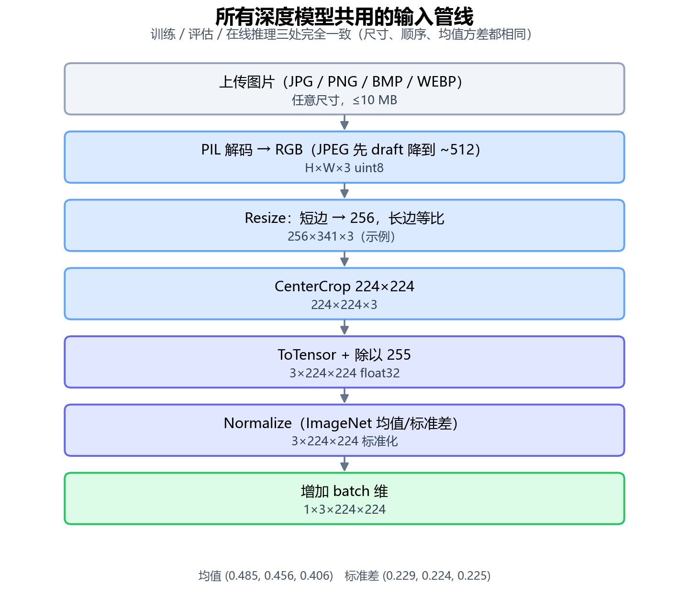

训练、验证/测试、后端在线推理**三处使用完全相同的预处理**，只是实现语言不同（torchvision vs numpy + PIL）：

| 步骤 | 做什么 | 输出 |
| --- | --- | --- |
| 1 | 校验格式（JPG/PNG/BMP/WEBP）、大小（≤10 MB） | 字节流 |
| 2 | PIL 解码、转 RGB；手机大图先用 JPEG draft 降到 ~512 | H×W×3 uint8 |
| 3 | 短边缩到 256，长边等比 | 256×341×3（示例） |
| 4 | 中心裁 224×224 | 224×224×3 |
| 5 | 转张量并除以 255 | 3×224×224 float32 |
| 6 | ImageNet 归一化：减均值、除标准差 | 3×224×224 |
| 7 | 增加 batch 维 | 1×3×224×224 |

三个容易踩坑的地方：

- **短边 256 + 中心裁 224**：保证主体在画面中心，同时给随机裁剪留出边距；训练用 `RandomResizedCrop(224, scale=(0.6,1.0))`，评估用 `Resize(256)+CenterCrop(224)`，两者不能混。
- **ImageNet 均值/标准差**：`(0.485,0.456,0.406)` / `(0.229,0.224,0.225)`。预训练权重是在这个分布上学的，换了均值和方差，精度会明显掉。
- **顺序不能变**：先 Resize 再 CenterCrop，先 ToTensor 再 Normalize；后端 `predictor.py` 是逐行复刻这套顺序的，任何一步换掉，离线指标和线上结果就对不上。

### 10.2 三种核心模块的内部计算

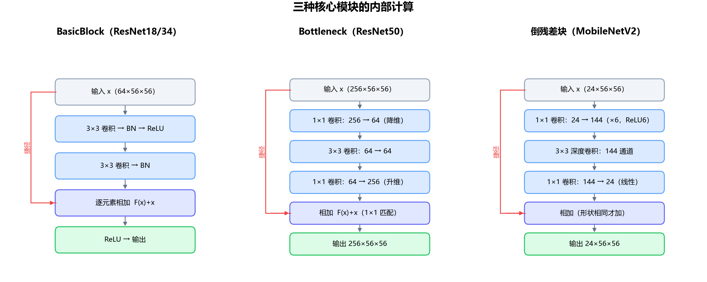

六个网络虽然层数不同，真正新东西只有三种模块：

**BasicBlock（ResNet18/34）**

```text
y = ReLU( BN(Conv3×3(ReLU(BN(Conv3×3(x))))) + x )
```

两个 3×3 卷积负责提特征，捷径把输入原样加回来。若输入输出通道或尺寸不一致（每个 stage 的第一块），捷径换成 `1×1 卷积 + BN` 做匹配。

**Bottleneck（ResNet50）**

```text
y = ReLU( BN(Conv1×1(ReLU(BN(Conv3×3(ReLU(BN(Conv1×1(x)))))))) + x )
```

1×1 先把通道压到 1/4（降维），3×3 在低维上做空间卷积，1×1 再升到 4 倍（升维）。所以 50 层网络每个 3×3 卷积的通道数并不大，"深"不等于"贵"。

**倒残差块（MobileNetV2）**

```text
y = Conv1×1_linear( DepthwiseConv3×3( ReLU6(Conv1×1_expand(x)) ) ) + x
```

与 Bottleneck 相反：先 1×1 把通道扩张 6 倍，3×3 深度卷积逐通道提特征，最后 1×1 压回低维且**不加激活**（线性瓶颈），避免低维信息被 ReLU 截断。

三个模块的共同点是"`F(x) + x`"：恒等捷径让梯度直接回传，深层网络才不会退化。

### 10.3 ResNet18（部署主模型）

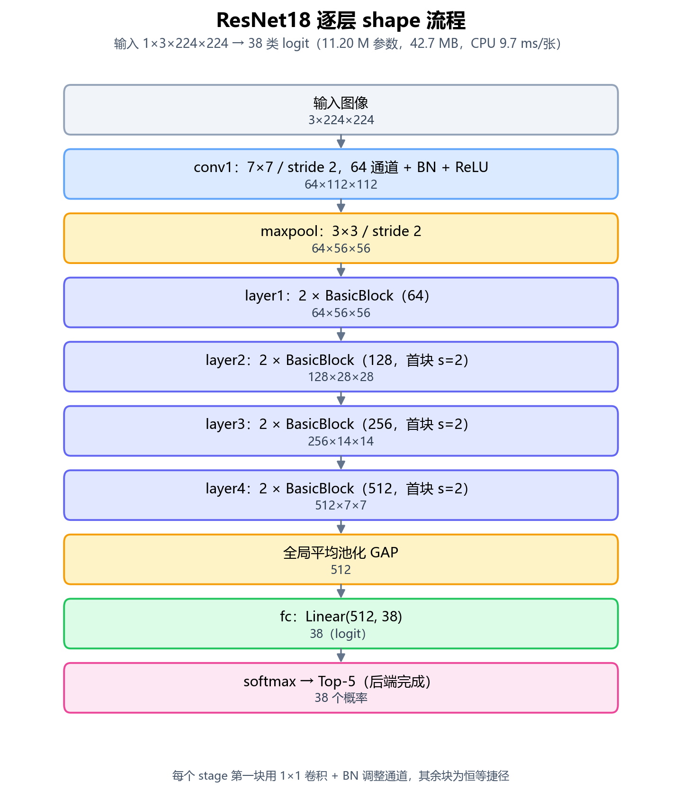

- **特征怎么来**：`layer4` 输出 512×7×7，GAP 对每个通道的 49 个数取平均，得到 512 维向量——这 49 个位置共享同一个类别语义，所以平均后与病斑在叶片上的位置无关。
- **分类头**：`zoo.py` 把 `fc` 换成 `Linear(512, 38)`，输出 38 个 logit；后端再做 softmax 取 Top-5。
- **本项目用法**：全网络微调（不是只训分类头），30 epoch、batch 32、Adam、warmup+余弦、标签平滑 0.1、类别加权，早停 patience=7。
- **实测**：11.20 M 参数，42.7 MB，CPU 9.7 ms/张，测试准确率 99.28%。

### 10.4 ResNet34

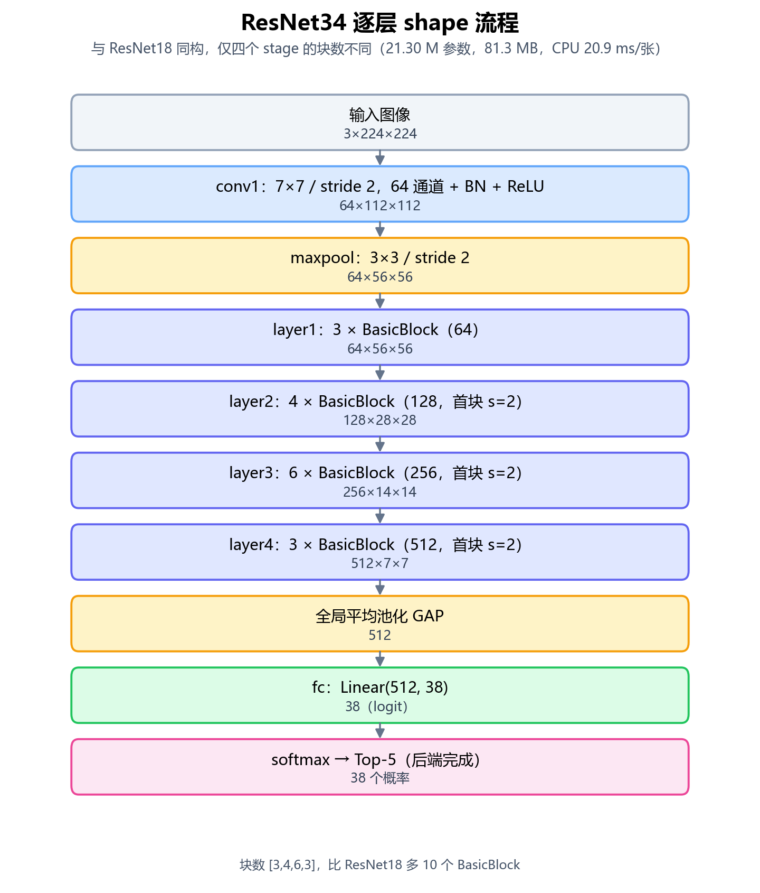

与 ResNet18 **完全同构**，只改四个 stage 的块数：

| 项目 | ResNet18 | ResNet34 |
| --- | --- | --- |
| 各 stage 块数 | `[2,2,2,2]` | `[3,4,6,3]` |
| 特征维度 | 512 | 512 |
| 参数量 | 11.20 M | 21.30 M |
| 模型体积 | 42.7 MB | 81.3 MB |
| CPU 单张 | 9.7 ms | 20.9 ms |
| 测试准确率 | 99.28% | 99.69% |

多出的 10 个 BasicBlock 里有一半集中在 `layer3`（6 块），所以它的收益主要来自更深的 mid-level 语义，而不是更大的分类头。

### 10.5 ResNet50

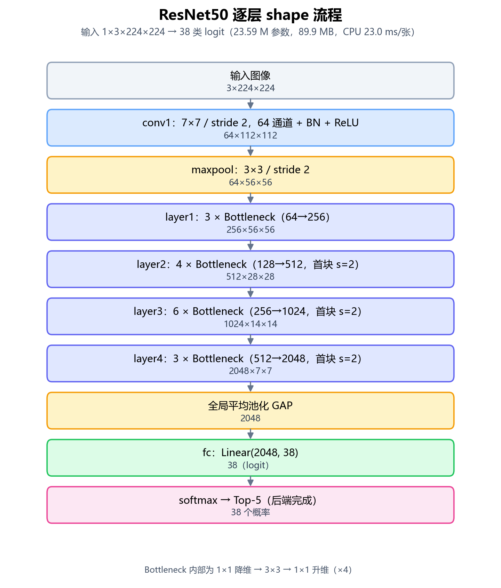

- 四个 stage 的输出通道变成 **256/512/1024/2048**（Bottleneck 的 4 倍扩张），GAP 后是 **2048 维**，分类头 `Linear(2048,38)`。
- 参数量 23.59 M（ResNet18 的 2.1 倍），体积 89.9 MB，CPU 23.0 ms/张。
- 测试准确率 99.40%，只比 ResNet18 高 0.12 个百分点——这是最终选择 ResNet18 的直接依据：多一倍多的参数和体积，换不来可感知的精度提升。

### 10.6 AlexNet（本项目改造版）

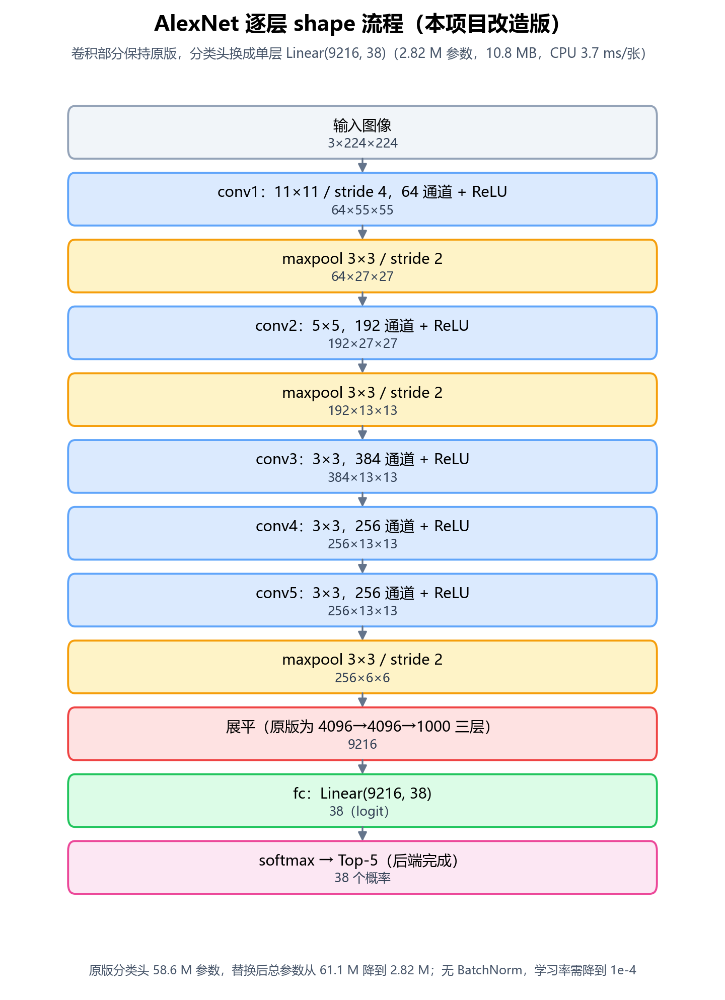

- 5 个卷积层全部保留：`11×11/4 → 5×5 → 3×3 → 3×3 → 3×3`，三个 3×3 卷积都不改变 13×13 的尺寸，最后池化到 6×6。
- **关键改造**：原版 `classifier` 是 `9216→4096→4096→1000`（58.6 M 参数），本项目换成**单层** `Linear(9216, 38)`，总参数从 61.1 M 降到 2.82 M，体积 10.8 MB。
- 没有 BatchNorm，对学习率敏感：首轮 1e-3 训练崩溃（train acc 掉到 0.28%），改用 1e-4 从头重训才收敛——这也是论文 4.2 节那段实验记录的来源。
- 实测 98.40%，是六个网络里最低的，符合"8 层、大卷积核"的表达力预期。

### 10.7 MobileNetV2

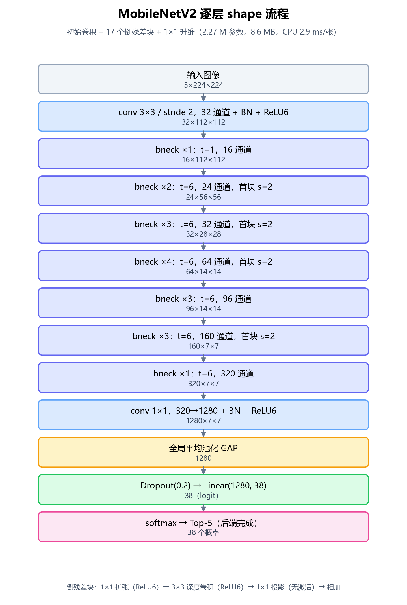

- 结构：1 个初始 3×3 卷积 + **17 个倒残差块** + 1 个 1×1 升维卷积（320→1280）+ GAP + `Linear(1280,38)`。
- **深度可分离卷积省在哪**：普通 3×3 卷积计算量约 `k²·Cin·Cout·H·W`；拆成"逐通道 3×3 + 1×1 通道混合"后约 `k²·Cin·H·W + Cin·Cout·H·W`，在 `Cout` 较大时能降 8~9 倍。
- 参数只有 2.27 M、8.6 MB，CPU 2.9 ms/张，测试准确率 **99.71%**（六个网络最高）。
- 没被选为部署主模型的原因不是精度，而是**量化后时延反而从 2.9 ms 升到 22.3 ms**（深度卷积在 CPU 上缺高效 int8 实现），部署不确定性更大——见论文 4.4/4.6 节的讨论。

### 10.8 MobileNetV3-Large

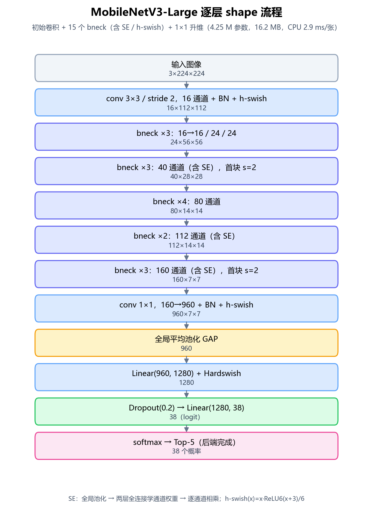

- 结构：初始 3×3 卷积（16 通道）+ **15 个 bneck 块** + 1×1 升维（160→960）+ GAP + `Linear(960,1280)` + Hardswish + Dropout + `Linear(1280,38)`。
- **SE 模块**：对每个块的特征图先全局平均池化得到通道描述 `s = GAP(F)`，经两层全连接学出权重 `w = σ(W₂·ReLU(W₁·s))`，再逐通道相乘 `F' = w ⊙ F`——让网络自己决定哪些通道重要。
- **h-swish**：`h-swish(x) = x · ReLU6(x+3) / 6`，是 swish 的硬件友好近似，比 ReLU 平滑、比 sigmoid 便宜。
- 参数量 4.25 M、16.2 MB，CPU 2.9 ms/张，测试准确率 99.66%。

### 10.9 六个网络的 shape 视角对照

| 模型 | 输入 | 最后卷积输出 | GAP 特征 | 分类头 | 输出 | 参数量 | 体积 | CPU 单张 |
| --- | --- | --- | ---: | --- | ---: | ---: | ---: | ---: |
| ResNet18 | 3×224×224 | 512×7×7 | 512 | Linear(512,38) | 38 | 11.20 M | 42.7 MB | 9.7 ms |
| ResNet34 | 3×224×224 | 512×7×7 | 512 | Linear(512,38) | 38 | 21.30 M | 81.3 MB | 20.9 ms |
| ResNet50 | 3×224×224 | 2048×7×7 | 2048 | Linear(2048,38) | 38 | 23.59 M | 89.9 MB | 23.0 ms |
| AlexNet | 3×224×224 | 256×6×6 | 9216（展平） | Linear(9216,38) | 38 | 2.82 M | 10.8 MB | 3.7 ms |
| MobileNetV2 | 3×224×224 | 1280×7×7 | 1280 | Dropout+Linear(1280,38) | 38 | 2.27 M | 8.6 MB | 2.9 ms |
| MobileNetV3-L | 3×224×224 | 960×7×7 | 960 | Linear(960,1280)→Linear(1280,38) | 38 | 4.25 M | 16.2 MB | 2.9 ms |

结论：**输入都是 224×224，输出都是 38**，差异全在"中间用什么方式把 224×224×3 压成特征向量"。ResNet 系列靠残差堆叠，AlexNet 靠大核卷积，MobileNet 靠深度可分离卷积——最后都归到同一个 38 维分类头上，所以它们可以共用同一套数据、同一套评估代码，也可以互相替换。

### 10.10 五个传统分类器：它们"运行"的是 512 维向量

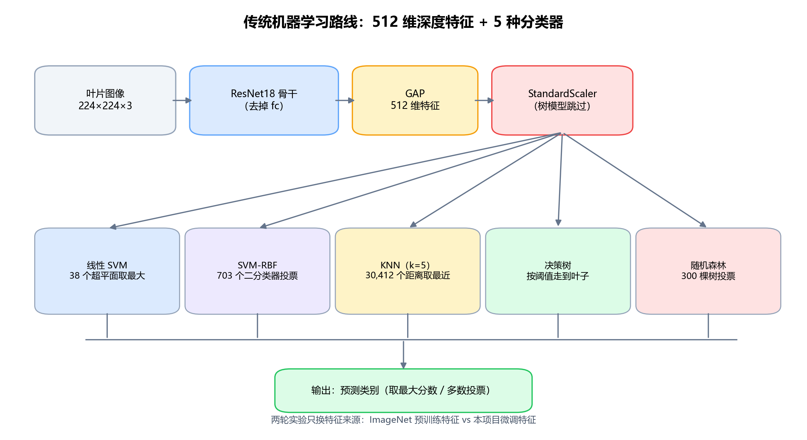

传统路线不直接对图像建模，而是把 ResNet18 的 GAP 输出当特征：

```text
图片 → ResNet18（去掉 fc）→ 512×7×7 → adaptive_avg_pool2d → 512 维向量
```

`train_ml.py` 里 `extractor = nn.Sequential(*list(model.children())[:-1])`，前向后再做一次 `F.adaptive_avg_pool2d(output, 1)` 并展平，得到 `N×512` 的特征矩阵。两轮实验只换特征来源：

| 轮次 | 特征来源 | 结果目录 |
| --- | --- | --- |
| 第一轮 | ImageNet 预训练 ResNet18 | `model/logs/ml/` |
| 第二轮 | 本项目微调 ResNet18 `best.pth` | `model/logs/ml_finetuned/` |

预测时每个分类器具体在算什么：

| 模型 | 预测计算 | 单张复杂度（N=30,412，d=512） |
| --- | --- | --- |
| 线性 SVM | 38 个超平面 `score_k = w_k·x + b_k`，取最大（OvR） | 38×512 ≈ 2 万次乘加 |
| SVM-RBF | 38 类两两配对 → **703 个二分类器**，每个算 `Σ α_t·K(sv_t,x)+b`，`K=exp(-γ‖x-sv‖²)`，最后投票（OvO） | 支持向量数 × 512 |
| KNN（k=5） | 算 `x` 到全部训练样本的欧氏距离，取最近 5 个投票 | 30,412×512 ≈ **1,558 万次**距离计算 |
| 决策树 | 从根节点按 `x_j ≤ t` 逐层走到叶子 | 一条路径，深度几十 |
| 随机森林 | 300 棵树各走一条路径，多数投票；每节点只随机看 `√512≈22` 个特征 | 300 × 深度 |

这解释了实验里的几个现象：

- **KNN 训练 0.2 s、预测最慢**：训练只是把特征存起来，预测要遍历全部训练集；
- **SVM-RBF 只抽 7,997 条训练**：核方法训练复杂度约 O(n²)~O(n³)，3 万条会爆内存；
- **决策树在 ImageNet 特征上只有 59.72%**：它只能做轴平行切分，512 维稠密特征里类别边界是斜的；
- **微调特征让所有分类器涨 4~39 个点**：瓶颈在特征，不在分类器。

### 10.11 一张图从上传到返回的完整时间线

| 步骤 | 做什么 | 典型耗时 |
| --- | --- | --- |
| 1 | 前端 `multipart/form-data` 上传，后端校验后缀/大小 | 取决于网络 |
| 2 | PIL 解码：JPEG draft 先降到 ~512，再转 RGB | 几 ms |
| 3 | 短边 256 → 中心裁 224 → 归一化 → `1×3×224×224` | 1~3 ms |
| 4 | ONNX Runtime 前向（ResNet18 FP32） | **约 9.7 ms** |
| 5 | softmax → 取 Top-5 → 按 `classes.txt` 映射类别名 | <1 ms |
| 6 | 用 Top-1 的 `class_name` 查 SQLite：症状、规律、传播途径、防治方案 | 1~3 ms |
| 7 | 返回 JSON（类别、置信度、Top-5、病害详情、防治方案、推理耗时） | — |

注意：后端返回的"推理耗时"**只统计第 4 步 `session.run`**，不含解码和预处理；论文里的 9.7 ms 也是这个口径。整条接口端到端约 10~14 ms（不含网络）。

### 10.12 训练时与推理时的差别

同一个网络，训练和推理跑的是两套逻辑：

| 项目 | 训练 | 推理 |
| --- | --- | --- |
| 模式 | `model.train()`：BN 用当前 batch 统计量，Dropout 生效 | `model.eval()` / ONNX：BN 用滑动平均，Dropout 关闭 |
| 输入 | 随机增强后的 224×224，batch=32 | 固定的 Resize+CenterCrop，batch=1 |
| 输出 | logits → 带标签平滑的加权交叉熵 → 反向传播 → Adam 更新 | logits → softmax → Top-5，不更新参数 |
| 精度 | 本机 CPU 为 FP32；ResNet34 在 RTX 3060 上用 AMP | 默认 FP32 ONNX；可选 INT8 动态量化 |
| 耗时 | 每轮十几分钟到几小时 | 单张 2.9~23 ms |

**训练一个 batch 的完整步骤**（`utils/engine.py`）：

```text
1. 取 32 张图，做随机增强，归一化
2. outputs = model(images)                 # 32×38 logits
3. loss = CrossEntropy(outputs, y, weight=w_c, label_smoothing=0.1)
4. loss.backward()                          # 反向传播
5. optimizer.step()                         # Adam 更新
6. 每个 epoch 结束跑验证集；连续 7 轮不提升则早停
7. 提升时保存 best.pth，每轮保存 last.pth（可断点续训）
```

### 10.13 部署：从 PyTorch 到 ONNX Runtime

```text
best.pth
→ torch.onnx.export（opset 13，输入名 input，batch 维动态）
→ onnxruntime.quantization.quantize_dynamic（可选，权重 FP32→QUInt8）
→ backend/models/resnet18.onnx
→ 后端启动时加载并预热，之后每个请求复用同一个 session
```

后端启动时做三件事：建 `InferenceSession`（`graph_optimization_level=ORT_ENABLE_ALL`、`intra_op_num_threads=min(8, CPU 核数)`）、读 `classes.txt` 固定类别顺序、用全 0 的 `1×3×224×224` 跑一次预热（把图优化和内存分配开销提前吃掉）。推理并发由信号量限制为 2（`CROP_MAX_CONCURRENT_INFERENCE`）。

**为什么量化后反而更慢**：动态量化只把权重存成 int8，激活值要在运行时逐 batch 量化/反量化，插入的 QuantizeLinear/DequantizeLinear 在卷积层多而小的 ResNet 上开销超过收益；MobileNet 的深度卷积在 CPU 上缺少高效 int8 kernel，2.9 ms 变成 22.3 ms。所以后端默认加载 FP32，只有存储受限时才用 `CROP_MODEL=quantized` 切换。

> **口径说明**：本文 4.5 / 5.4 / 6.4 节的"量化 0.3806 / 0.19 / 0.20"是**单个随机张量**上、量化输出与 PyTorch 输出的 logit 最大差；论文表 4-6 用的是**1,000 张真实测试图**上的统计（最大差异 0.43~1.95，argmax 一致率 99.8%~100%）。两者不矛盾，但采样口径不同，引用时需注明。

> 本节 9 张流程图由 `docs/make_model_diagrams.py` 用 matplotlib 生成，修改网络结构或层数后可重新运行该脚本更新配图。

---

## 附录 A：关键术语

| 术语 | 含义 |
| --- | --- |
| 残差连接 | `y = F(x) + x` 的跨层捷径，解决深层网络退化与梯度消失 |
| Bottleneck | 1×1→3×3→1×1 的残差块，通道数先降后升 |
| 深度可分离卷积 | 逐通道 3×3 卷积 + 1×1 逐点卷积，大幅降低计算量 |
| 倒残差 | 先扩张通道、再深度卷积、后压缩的残差结构（MobileNetV2） |
| 线性瓶颈 | 低维压缩层后不加激活函数，避免信息损失 |
| SE 模块 | 通道注意力：全局池化后学习各通道权重再重标定 |
| h-swish | `x·ReLU6(x+3)/6`，swish 的硬件友好近似 |
| 迁移学习 | 复用 ImageNet 预训练权重并在目标任务上微调 |
| 支持向量 | 决定 SVM 分类边界的关键训练样本 |
| 核技巧 | 不显式计算高维映射，只用核函数度量相似度 |
| Bagging | 有放回抽样训练多个模型再投票的集成方法 |
| 基尼不纯度 | 衡量节点类别混杂程度，CART 的划分依据 |
| macro / weighted | 指标按类平均 / 按样本数加权的两种聚合方式 |
| 动态量化 | 部署时把权重量化为 int8，压缩体积的压缩技术 |

## 附录 B：参考文献

**深度学习**

1. He K, Zhang X, Ren S, et al. Deep residual learning for image recognition[C]//CVPR. 2016: 770-778.
2. Krizhevsky A, Sutskever I, Hinton G E. ImageNet classification with deep convolutional neural networks[C]//NeurIPS. 2012: 1097-1105.
3. Sandler M, Howard A, Zhu M, et al. MobileNetV2: Inverted residuals and linear bottlenecks[C]//CVPR. 2018: 4510-4520.
4. Howard A, Sandler M, Chu G, et al. Searching for MobileNetV3[C]//ICCV. 2019: 1314-1324.
5. Howard A G, Zhu M, Chen B, et al. MobileNets: Efficient convolutional neural networks for mobile vision applications[J]. arXiv:1704.04861, 2017.

**传统机器学习**

6. Cortes C, Vapnik V. Support-vector networks[J]. Machine Learning, 1995, 20(3): 273-297.
7. Breiman L. Random forests[J]. Machine Learning, 2001, 45(1): 5-32.
8. Breiman L, Friedman J, Stone C J, et al. Classification and Regression Trees[M]. Chapman & Hall/CRC, 1984.
9. Cover T, Hart P. Nearest neighbor pattern classification[J]. IEEE Transactions on Information Theory, 1967, 13(1): 21-27.
10. 李航. 统计学习方法[M]. 第 2 版. 北京: 清华大学出版社, 2019.
11. Pedregosa F, Varoquaux G, Gramfort A, et al. Scikit-learn: Machine learning in Python[J]. JMLR, 2011, 12: 2825-2830.

**数据集与应用**

12. Mohanty S P, Hughes D P, Salathé M. Using deep learning for image-based plant disease detection[J]. Frontiers in Plant Science, 2016, 7: 1419.
13. Hughes D P, Salathé M. An open access repository of images on plant health to enable the development of mobile disease diagnostics[J]. arXiv:1511.08060, 2015.
